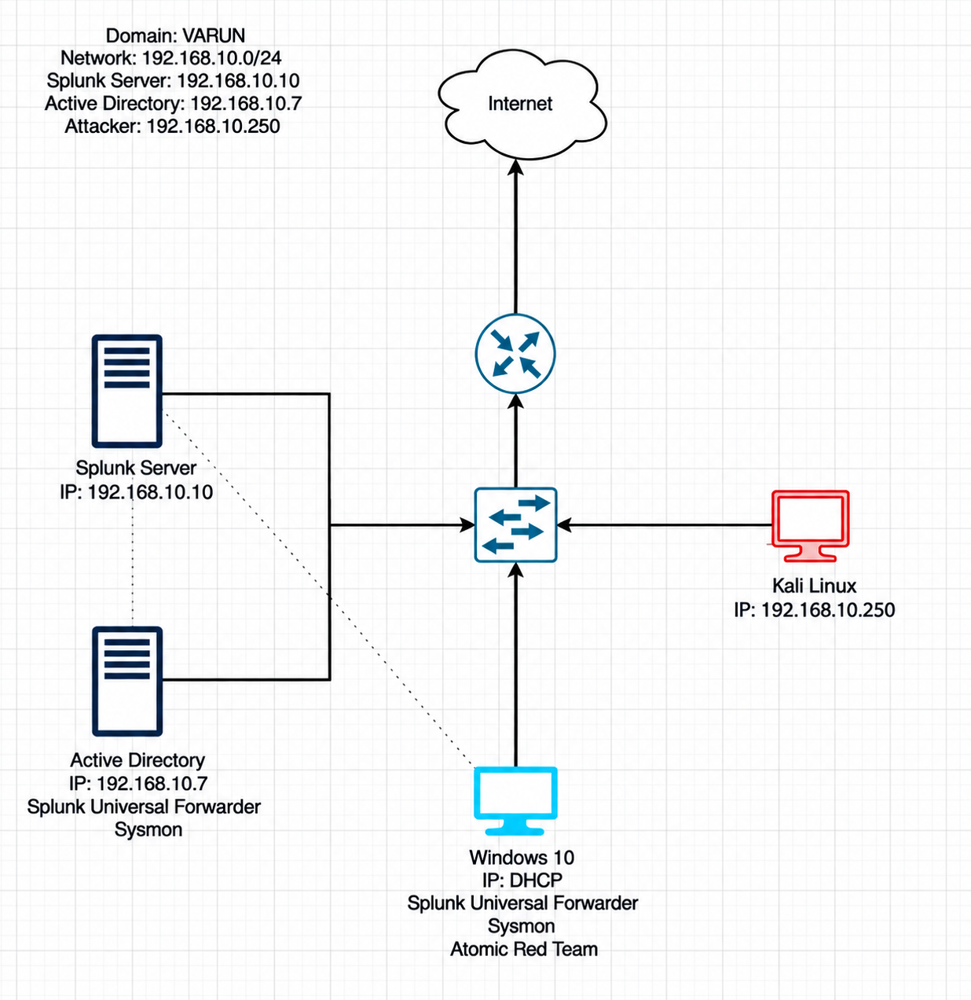

# SOC Home Lab: Windows Domain Monitoring with Splunk

A self-built detection lab that mirrors a small corporate Windows environment
— an Active Directory domain, a monitored endpoint, and a centralized SIEM —
paired with a live attack scenario to prove the monitoring actually catches
something. The goal was to go through the full loop a SOC analyst deals with
daily: collect logs, get attacked, find it in the data, and confirm it with a
second, independent detection method.

> **Scope note:** every machine here runs inside a private VirtualBox network
> that has no route to anything outside the lab. Nothing external was ever
> targeted.

---

## Table of Contents
- [What's in this lab](#whats-in-this-lab)
- [Skills practiced](#skills-practiced)
- [Environment layout](#environment-layout)
- [Walkthrough](#walkthrough)
- [ATT&CK coverage](#attck-coverage)
- [What I took away from this](#what-i-took-away-from-this)

---

## What's in this lab

Four VMs, one isolated network:

- A **Windows Server** promoted to a Domain Controller (`varun.local`)
- A **Windows 10** machine joined to that domain, running as the "employee"
  endpoint
- An **Ubuntu** box running **Splunk Enterprise** as the central log
  destination
- A **Kali Linux** machine playing the role of an external attacker

Sysmon and the Splunk Universal Forwarder run on both Windows machines,
shipping Security/System/Application/Sysmon events into Splunk. From there,
an RDP password-spraying attack is launched from Kali, and the resulting
telemetry is used to catch it in Splunk. A second round using Atomic Red Team
generates additional detections mapped to MITRE ATT&CK.

## Skills practiced

- Standing up and administering a Splunk Enterprise instance
- Forwarding Windows logs with the Universal Forwarder + Sysmon
- Reading raw Windows Security events (specifically logon events 4624/4625)
- Standing up Active Directory: forest creation, OUs, user provisioning,
  domain join
- Basic Linux networking (netplan, static addressing)
- Running a credential attack (Hydra against RDP) and understanding what it
  looks like from the defender's chair
- Using Atomic Red Team to generate realistic, ATT&CK-mapped telemetry for
  detection validation

## Environment layout

Everything lives on one VirtualBox NAT network (`192.168.10.0/24`).

| Host           | Purpose                          | IP              |
|----------------|-----------------------------------|-----------------|
| Splunk         | Central SIEM (Ubuntu)             | 192.168.10.10   |
| DC             | Domain Controller (`varun.local`) | 192.168.10.7    |
| Endpoint       | Domain-joined Windows 10 target   | DHCP (dynamic)  |
| Attacker       | Kali Linux                        | 192.168.10.250  |
| Gateway        | NAT network gateway               | 192.168.10.1    |

## Walkthrough

Full build notes, with a screenshot at every step, are broken out by phase
under `/docs`:

1. [Phase 1 — Standing up the VMs](docs/phase1-lab-setup.md)
2. [Phase 2 — Log collection with Splunk + Sysmon](docs/phase2-splunk-sysmon.md)
3. [Phase 3 — Active Directory buildout](docs/phase3-active-directory.md)
4. [Phase 4 — Attack simulation and detection](docs/phase4-attack-and-detection.md)

## ATT&CK coverage

| Technique    | Name                              | Where it shows up in this lab       |
|--------------|------------------------------------|---------------------------------------|
| T1110        | Brute Force                        | RDP credential guessing against the endpoint |
| T1136.001    | Create Account — Local             | Simulated via Atomic Red Team          |
| T1059.001    | Command and Scripting Interpreter: PowerShell | Simulated via Atomic Red Team |

## What I took away from this

Building this made the gap between "having logs" and "having *useful* logs"
very concrete — an index with millions of raw events is worthless without
knowing which event IDs actually matter for a given attack. Watching a brute
force attempt show up as a wall of 4625s followed by a single 4624 made that
distinction click instantly, and having Atomic Red Team available meant I
could reproduce that same "collect → detect → confirm" loop for other
techniques without needing a live attacker every time.

---

*Built by Varun — [LinkedIn](https://www.linkedin.com/in/varunb-/) · [GitHub](https://github.com/VARUN-B18)*
