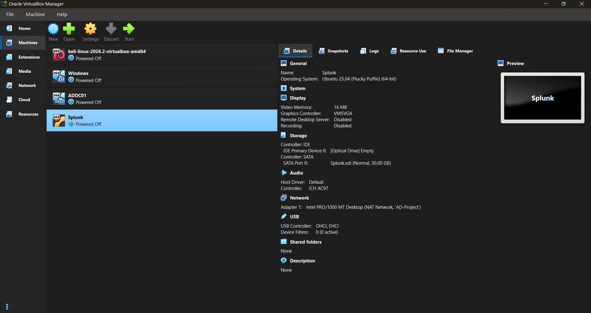

# Phase 1 — Standing up the VMs

Before any networking or configuration, four virtual machines need to exist.

## What to install

1. **VirtualBox** — the hypervisor everything runs on.
2. **Windows 10 (22H2)** — this becomes the domain-joined endpoint later.
3. **Kali Linux** (prebuilt VM) — extract the archive and import the `.vbox`
   file directly; no manual OS install needed.
4. **Windows Server 2022** (64-bit ISO) — this will be promoted to a Domain
   Controller in Phase 3.
5. **Ubuntu Server** — this hosts Splunk.

> Add a screenshot of your VirtualBox Manager here showing all four VMs, e.g.

At this point none of the machines are networked together yet — that's
handled at the start of Phase 2.

---
➡️ Next: [Phase 2 — Log collection with Splunk + Sysmon](phase2-splunk-sysmon.md)
