# Phase 2 — Log collection with Splunk + Sysmon

**Goal:** get Sysmon and the Splunk Universal Forwarder running on both
Windows machines so their event logs flow into the Splunk server.

## Wire up the network first

1. In VirtualBox, create a NAT Network (e.g. `varun-lab`) with subnet
   `192.168.10.0/24` and apply it.
2. Attach all four VMs to this NAT Network under **Settings → Network**.

## Give the Splunk server (Ubuntu) a static IP

1. Check the current (DHCP) address:
   ```bash
   ip a
   ```
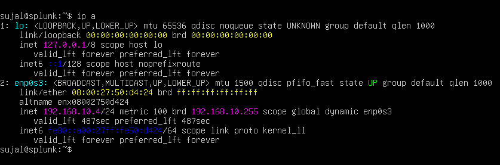
2. Edit the netplan config:
   ```bash
   sudo nano /etc/netplan/00-installer-config.yaml
   ```
   Set `dhcp4: no`, a static address of `192.168.10.10/24`, nameserver
   `8.8.8.8`, and a default route through `192.168.10.1`.
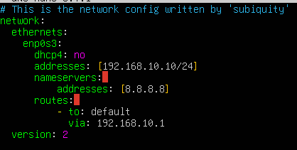
3. Apply it:
   ```bash
   sudo netplan apply
   ```
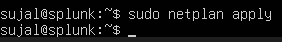
4. Confirm the change and test connectivity:
   ```bash
   ip a
   ping google.com
   ```
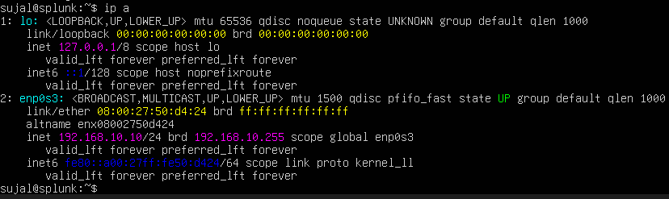
## Get Splunk Enterprise installed

Download the `.deb` package on the host machine, then bring it into the VM
via a VirtualBox shared folder.

5. Install the guest additions package:
   ```bash
   sudo apt-get install virtualbox-guest-additions-iso
   ```

6. Add the shared folder in **Devices → Shared Folders**.
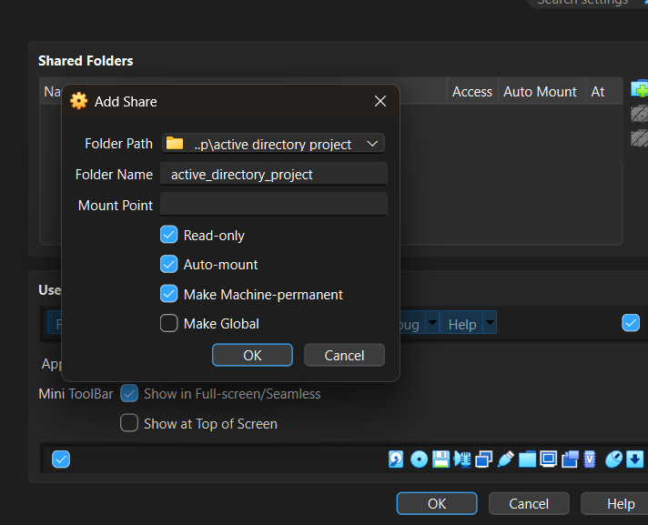
7. Install guest utils and reboot:
   ```bash
   sudo apt-get install virtualbox-guest-utils
   sudo adduser <your-username> vboxsf
   mkdir share
   ```

8. Mount the shared folder:
   ```bash
   sudo mount -t vboxsf -o uid=1000,gid=1000 <shared_folder_name> share/
   ```
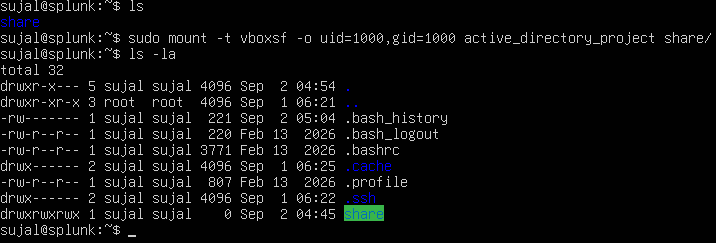
9. Install Splunk from the mounted folder:
   ```bash
   cd share
   sudo dpkg -i splunk-<version>-linux-amd64.deb
   ```
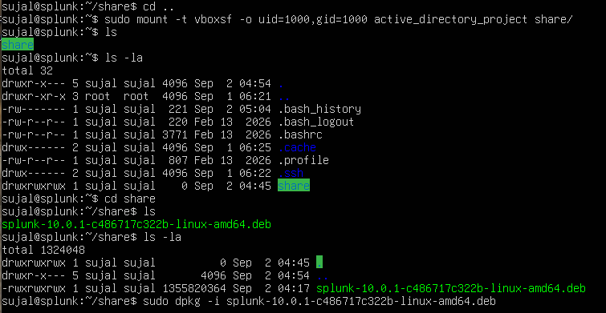
10. Start Splunk under its own service account:
    ```bash
    cd /opt/splunk
    sudo -u splunk bash
    cd bin
    ./splunk start
    ```
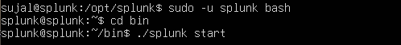
11. Set Splunk to launch automatically on every boot:
    ```bash
    exit
    sudo ./splunk enable boot-start -user splunk
    ```
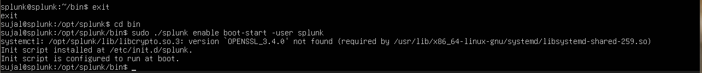
## Set up the Windows target endpoint

1. Rename the machine, then set a static IP:
   - IP `192.168.10.100`, mask `255.255.255.0`, gateway `192.168.10.1`,
     DNS `8.8.8.8`
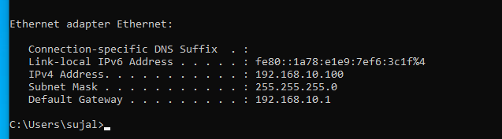
2. Confirm the Splunk web UI loads at `192.168.10.10:8000`.

### Universal Forwarder

- Install the Windows Universal Forwarder, point the receiving indexer at
  `192.168.10.10:9997`.

### Sysmon

- Install Sysmon using the SwiftOnSecurity/Olaf community config
  (`sysmonconfig.xml`):
  ```powershell
  .\Sysmon64.exe -i ..\sysmonconfig.xml
  ```

### The critical piece: `inputs.conf`

Under `C:\Program Files\SplunkUniversalForwarder\etc\system\local\`, add an
`inputs.conf` (template in [`/configs/inputs.conf`](../configs/inputs.conf))
telling the forwarder to ship Application/Security/System/Sysmon logs into
an index named **`endpoint`**. If that index doesn't exist on the Splunk
server side, this data goes nowhere — create it first (see below), then
restart the SplunkForwarder service any time `inputs.conf` changes.

## Wire up the Splunk server to receive

- Create the index: **Settings → Indexes → New Index → `endpoint`**
- Enable a receiving port: **Settings → Forwarding and receiving → Configure
  receiving → New receiving port → `9997`**

Confirm data is landing:
```spl
index="endpoint"
```
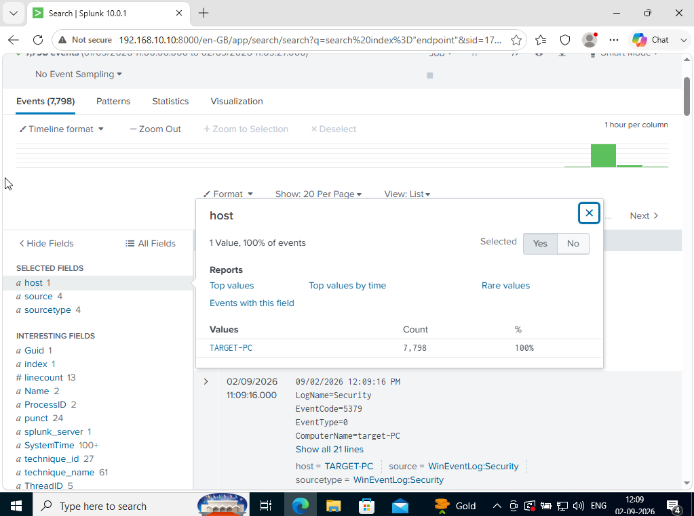
## Repeat for the Domain Controller

Same forwarder + Sysmon setup, different host name and IP
(`192.168.10.7`). Don't recreate the `endpoint` index — it already exists.

---
➡️ Next: [Phase 3 — Active Directory buildout](phase3-active-directory.md)
